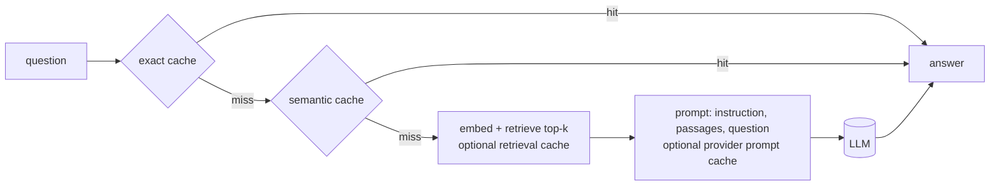

# cache-rag-gateway

**What does each layer of LLM caching actually save, and what does it cost you in correctness?**

A small RAG gateway where every cache layer can be switched on or off, plus an evaluation harness that measures cost, latency, answer quality, wrong answers served and staleness against SQuAD gold answers. All results come from real runs logged in [`runs/`](runs/), on a local 4B model (Ollama) and on Claude Sonnet 5.5.



## What I found

| Layer | What it saved | What it cost |
|---|---|---|
| **Exact cache** | A hit takes 0.1-0.2 ms instead of 4.6-5.7 s (local model). On Claude: 15% fewer calls and 15% lower cost at 15% repeated requests. | No wrong answers. But with no invalidation it served the **old number for 29 of 30** questions after the data changed. |
| **Semantic cache** (threshold 0.90) | On Claude: 39% of requests answered from cache, **39% lower cost**, median latency about 6% lower. | The tail did not improve (p95/p99 are misses). **4 wrong answers per run**, all on same-paragraph near-miss questions (11% of them). No threshold serves most paraphrases and almost no wrong answers. |
| **Retrieval cache** (keyed on query similarity) | Makes the passage block repeat, which is what lets prompt caching work. Locally: requests with a nearly fully cached prompt rose from 19% to 55%. | Accuracy: a question borrows a similar question's passages. F1 fell 0.014 locally (0.740 to 0.726) and about 0.02-0.03 on Claude. |
| **Prompt / prefix cache** | **Local:** prompt time down 30-39%; median first-token time about 3-4 s to about 0.3 s when combined with the retrieval cache. | **Claude:** caching raised cost 18% with relevance-ordered passages and 20-25% on a diverse workload (cache writes cost 25% extra). Only with the retrieval cache did it pay: **23% cheaper**. It did **not** improve latency. |
| **Invalidation by data version** | Stale answers 29 of 30 (97%) without it, **0 of 30** with it. | Cached answers are discarded on every data change. |

Three takeaways:

1. **Prompt caching is a latency lever on a local model and a cost lever on an API.** Locally, prompt processing is slow, so reusing it matters. On Claude it already takes about 1 s, and writing a cache entry made first-token time 20-28% *slower*.
2. **Caching can cost more than it saves.** With Claude's pricing, cost is about `1 + 0.25 x (share written) - 0.9 x (share read)` of the prompt cost. Without prefix reuse it is a pure surcharge.
3. **Similarity is not equivalence.** The semantic cache's worst wrong answers scored 0.93-0.98 similarity: a swapped question word ("who" vs "when") or an opposite ("before" vs "after") barely moves an embedding.

### Claude Sonnet 5.5 vs local Qwen3 4B (same 200 questions, identical retrieval, no caches)

| | Claude Sonnet 5.5 | Qwen3 4B on a MacBook Air |
|---|---|---|
| F1 / exact match | 0.82-0.84 / 0.62-0.64 (3 runs) | 0.696 / 0.520 |
| Latency p50 / p95 / p99 | 1.4 s / 1.7-1.8 s / 1.9-2.0 s | 4.7 s / 6.9 s / 8.4 s |
| Cost per 200 questions | $0.595 | $0 |
| Repeatable? | **No**: 141 of 200 answers identical across 3 runs | Yes (temperature 0 and a seed) |

Retrieval was the same for both, so the gap is generation. Claude's latency includes the network and Qwen ran on a fanless laptop, so read these as results for this setup, not a pure model comparison.

### The same ablation on the local model

Qwen3 4B on the MacBook Air, 134 requests per arm (40 originals, 40 paraphrases, 24 same-paragraph near-misses, 10 other-article questions, 20 exact repeats), 2 repetitions, 7 arms interleaved per request, free.

| Arm | Answered from cache | Model calls | Median latency | p95 |
|---|---|---|---|---|
| none (control) | 0% | 134 | 5.0 s | 7.5 s |
| exact | 15% | 114 | 4.8 s (-4%) | 7.1 s (-5%) |
| semantic | 34% | 88 | 4.5 s (-10%) | 7.1 s (-6%) |
| exact + semantic | 34% | 88 | 4.5 s (-10%) | 7.1 s (-5%) |
| all layers | 34% | 88 | 4.4 s (-11%) | 7.0 s (-7%) |

Cost in tokens fell with calls (-15% exact, -35% semantic). The semantic cache answered 65% of paraphrases and every repeat. It served **0 wrong answers out of 24 near-miss questions** here, against 4 of 36 on the Claude run. The cache decides from embeddings alone and never involves the model, so that difference comes from the two different question samples and cache sizes, not from a safer model.

Noise: the control and its identical copy differed by 2.8% in median latency and 0.006 F1 and disagreed on 3.7% of answers. But arms whose prompts start with a different label disagreed with the control on 8-17% of answers, so F1 differences of about 0.04 between arms are label noise, not cache effects. A small model's answers shift when the first few tokens of a prompt change.


## How it was measured

- **Data:** a fixed, seeded subset of SQuAD v1.1 dev: 500 paragraphs, 2,566 questions ([`data/eval/squad-subset.json`](data/eval/squad-subset.json), hash recorded in every run). Scoring is the official SQuAD method (best F1 and exact match over all accepted answers).
- **Arms are interleaved.** In the ablation every cache configuration answers the *same* request, back to back in a seeded random order, so slow drift in the machine or network hits every arm alike. Each arm has private caches and its own prompt-cache namespace, so arms cannot warm each other.
- **A noise floor, not a guess.** An identical copy of the control arm runs in the same schedule. On Claude the two disagreed on 25% of answers and differed by 0.013 F1, so only differences beyond that count.
- **Reproducibility:** pinned model digest and embedding revision, exact dependency versions, seeds. The local model at temperature 0 reproduced 20 of 20 re-asked answers. Claude's newest models reject `temperature`, so those runs are not repeatable and every Claude claim is made against the measured noise floor.
- **Cost control:** token counts measured with the free token-counting endpoint before spending, and a persistent spend ledger that caps cost across *all* runs. The whole Claude programme cost about $19.

## Run it

Needs Node 24 and [Ollama](https://ollama.com).

```bash
npm install
ollama pull qwen3:4b-instruct
npm run index                        # embeds the 500 paragraphs locally (downloads bge-small, about 130 MB, once)
npm run eval -- --name baseline      # 200 questions, no caches; writes runs/baseline.jsonl + .summary.json
npm test                             # all tests, no model needed
```

Run it as an HTTP service (the caches that are switched on in the config are the ones it uses):

```bash
npm run serve        # http://localhost:8080
curl -s localhost:8080/health
curl -s -X POST localhost:8080/ask -H 'content-type: application/json' -d '{"question":"Who was the NFL Commissioner in early 2012?"}'
curl -s localhost:8080/stats
```

As a container (the image builds its own vector index and bakes in the embedding model, runs as an unprivileged user, and is about 1.6 GB):

```bash
docker build --platform linux/arm64 -t cache-rag-gateway .
docker run --rm -p 8080:8080 --env-file .env -e GATEWAY_API_KEY=local-test -e SPEND_CAP_USD=1 cache-rag-gateway
```

Set `GATEWAY_API_KEY` to require an `x-api-key` header on `/ask` and `/stats` (without it the service warns that it is open), and `SPEND_CAP_USD` to cap what it may spend.

The seeded subset and the generated paraphrases are committed. To rebuild the subset from the raw dataset (public, CC BY-SA 4.0, 4.9 MB):

```bash
curl -L -o data/raw/dev-v1.1.json https://rajpurkar.github.io/SQuAD-explorer/dataset/dev-v1.1.json
npm run subset
```

Compare cache configurations (interleaved, repeated, with a noise-floor twin), then build the report:

```bash
npm run ablation -- --name my-ablation --reps 2 --originals 40
npx tsx scripts/ablation-report.ts runs/my-ablation.summary.json   # writes reports/ablation-report.html
npm run staleness -- --name my-staleness --k 30                    # stale answers with and without invalidation
```

To use Claude instead of the local model, put `ANTHROPIC_API_KEY` in `.env` (see `.env.example`; it is gitignored) and add `--override configs/providers/claude_sonnet.yaml`. The config carries a hard spend cap; 200 questions cost about $0.60.

Any model can be plugged in through the provider interface in [`src/providers/`](src/providers/): Ollama, Anthropic, any OpenAI-compatible server (LM Studio, vLLM, OpenRouter...), or your own `registerProvider(...)`.

## Deployed on AWS (ECS Fargate)

The container image runs unchanged on AWS. I set it up by hand in `ap-southeast-2` (Sydney) to check that the service works outside my laptop:

- **Image:** pushed to a private ECR repository as `v1` (the arm64 image is 498 MB compressed).
- **Run:** one ECS Fargate task (ARM64, 1 vCPU, 2 GB) in a default-VPC public subnet with a public IP. There is no load balancer and no NAT gateway, to avoid their hourly cost.
- **Secrets:** the Anthropic key and the gateway key are SSM Parameter Store `SecureString` values. ECS injects them as environment variables when the task starts, so they are not in the image or the task definition.
- **Permissions:** the execution role has the managed ECS policy plus `ssm:GetParameters` on one path. There is no task role, because the gateway makes no AWS calls. The IAM user that pushed the image can only use ECR.
- **Network:** the security group allows TCP 8080 from one IP address (`/32`), and `/ask` and `/stats` also need the `x-api-key` header.
- **Logs:** CloudWatch Logs, 7-day retention. The health check is defined in the task definition, because ECS ignores the Dockerfile's `HEALTHCHECK`.

One real test on the running task: the first `/ask` took 2,359 ms and cost $0.0035; the same question again was answered by the exact cache in 0 ms for $0; a request without the key got `401`. These latencies are measured inside the container, not from a client.

Limits of this setup: one task, no TLS, no autoscaling, and the caches and the spend ledger live inside the container, so they reset when the task is replaced (the ledger's cap protects one task run, not a whole budget). It is a test deployment, not a production design. I stopped the task after testing so it does not keep billing.

## Layout

```
src/cache/        exact.ts, semantic.ts, retrieval.ts   the cache layers (SQLite / in memory), TTL, data-version keys
src/providers/    ollama, anthropic, openai-compatible   one interface, one wrapper (src/llm.ts) with timing and the spend cap
src/rag/          squad loader, seeded subset, vector index, prompt
src/eval/         metrics, workloads, arms, stats, staleness, report
src/serve.ts      the HTTP service (src/server.ts: /ask, /health, /stats, API key)
eval/             run.ts, ablation.ts, staleness.ts      the runners
scripts/          probes, analyses, report builder, live monitors
configs/          base config, provider and ablation overrides
runs/             logged results (JSONL per request, summary JSON per run)
reports/          generated HTML reports
```

## Limitations

- One dataset (short-answer SQuAD) and small models; the paraphrases were generated by the local 4B model and are probably easier than human rewordings.
- The workloads are synthetic. The "concentrated" workload (100 questions over 20 paragraphs) flatters any form of prefix reuse; the "diverse" one shows the opposite. Real traffic mixes are unknown, so no single overall "wrong-answer rate" is claimed.
- Caches here hold hundreds of entries, not millions; a larger cache has more near neighbours and so more chances of a wrong match.
- Claude is not repeatable and, as the most capable setup, was measured with three repetitions at most. A first control arm in the prefix-cache runs on the local model was contaminated by an earlier test (its first 10 requests), and the analysis excludes those.
- `runs/claude-baseline-a.jsonl` has no summary file: its summary step crashed on a bug (since fixed) after all 200 answers were written, so its numbers here come from the rows themselves.
- All local numbers come from one MacBook Air (Apple M4, 16 GB) running Ollama 0.35.1.

## License

MIT, see [LICENSE](LICENSE). SQuAD is CC BY-SA 4.0.
